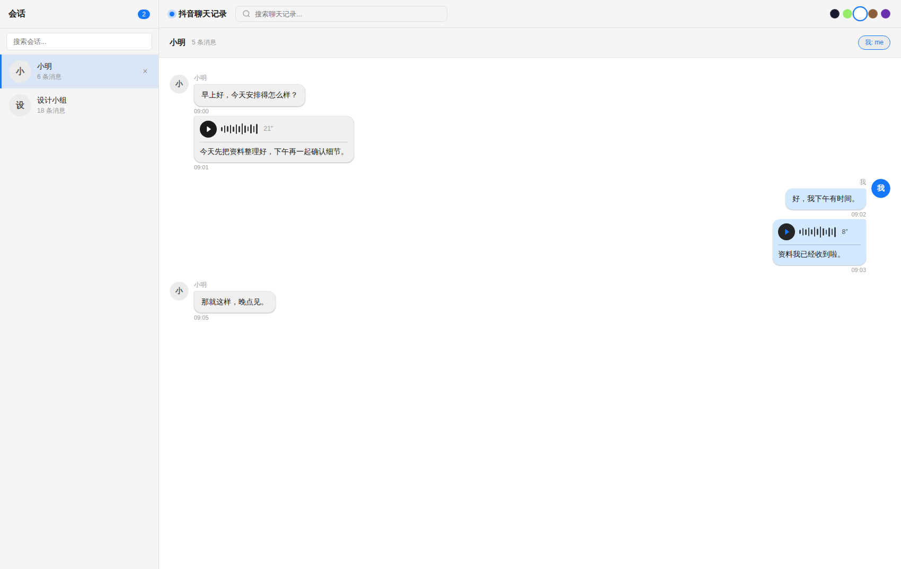
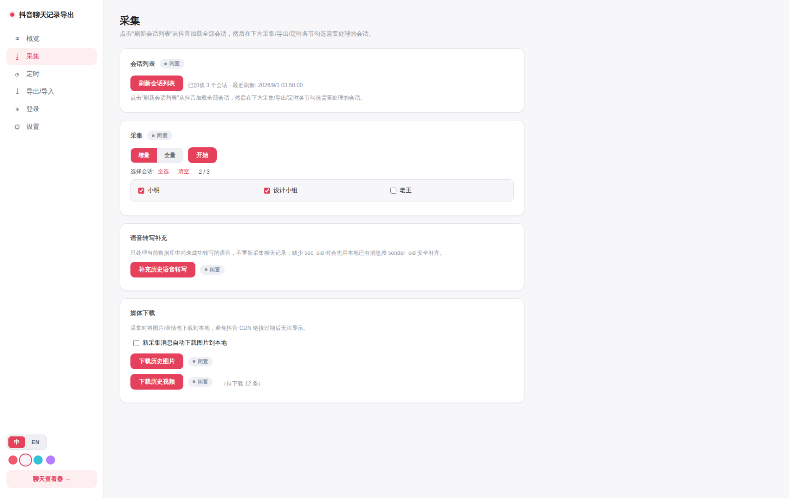

<div align="center">

项目由Deepseek Harness+Deepseek-V4.1 Flash 辅助完成

# 抖音聊天记录导出工具

**从抖音网页版完整导出私信聊天记录，本地 Web 界面浏览、搜索、导出。**

直接调用抖音 IM 接口（protobuf）抓取，突破网页虚拟列表的滚动上限，可导出完整历史。

</div>

> **本项目**由 **AceovoeL** 维护：<https://github.com/AceovoeL/DouKeep-douyin-chat-export>
> 基于 **TeamBreakerr** 的原创项目 [douyin-chat-export](https://github.com/TeamBreakerr/douyin-chat-export) 修改而来，采用 MIT 许可（全文见 [LICENSE](LICENSE)，第三方素材说明见 [NOTICE](NOTICE)）。
> 控制面板（`/panel`）→ **关于** 里可以看到作者信息、当前版本号，并一键检查更新。

<div align="center">
  
</div>

> **目录** ·
> [功能](#功能) ·
> [环境要求](#环境要求) ·
> [快速开始](#快速开始) ·
> [部署](#部署) ·
> [使用](#使用) ·
> [控制面板](#控制面板) ·
> [开放 API](#开放-api) ·
> [注意事项](#注意事项)

---

## 功能

- **完整采集** — 直接调用抖音 IM 接口，不受网页版虚拟列表滚动上限限制；支持增量更新和各类消息
- **语音转写** — 新消息自动转文字，历史语音可一键补充
- **媒体本地化** — 图片、语音、视频、实况图、表情和卡片素材自动存到 `data/media/`，CDN 链接过期后仍能显示，浏览器不支持的视频按需转码
- **聊天浏览** — 无限滚动、会话内搜索、按日期定位与筛选、左右分栏、引用回复、图片与音视频播放、合并转发展开、5 套主题
- **互动卡片** — 分享、火花、合养小火人、喂精灵、陪伴天数、彩蛋福袋等卡片按抖音客户端样式还原
- **数据洞察** — 每个会话的热力图、消息排行、常用表情、连续聊天天数、高频关键词，全部本机计算
- **导出** — ChatLab JSON / JSONL、纯文本 TXT、单文件 HTML（TXT 与 HTML 可按日期区间导出），也可整库导出 SQLite
- **远程同步** — 实现 ChatLab Pull 协议，在 ChatLab 里添加本服务地址即可自动增量同步
- **开放 API** — 只读 REST API，可取消息和日统计，也能把消息区间渲染成聊天长图
- **控制面板** — 采集、导出、定时任务、登录、局域网与公网访问、密码保护、更新检查
- **纯本地** — 装一次依赖、构建一次前端就能跑，数据都在项目目录里（见[数据放在哪](#数据放在哪)）

## 环境要求

第一次用请先对照下表确认三样东西：

| 需要 | 版本 | 干什么用 |
|------|------|----------|
| **Python** | 3.10 或更高 | 跑后端、采集、导出 |
| **Node.js + npm** | Node.js 20.19+ 或 22.12+ | 只用来构建一次前端界面（Vite 7 的要求）；平时运行不需要它 |
| **磁盘空间** | 2 GB 以上 | 依赖、前端构建产物、约 700 MB 的浏览器内核，以及后面下载的聊天媒体 |

> 不确定装没装、版本对不对？Windows 双击仓库根目录的 **`start.html`**，它会自动检测并列出每一项
> （详见下面的[方式 A](#方式-a第一次用windows一键启动)）；手动看的话，跑 `python --version` 和 `node --version` 就够了。
>
> 采集、导入 Cookie、聊天长图要用的 **Playwright Chromium** 由启动脚本自动下载（约 700 MB）；真正可选装的只有 **ffmpeg**（不装则 H.265 视频播不了）。缺什么可以在面板 **关于 → 环境检测** 里看。

## 快速开始

第一次用有三种方式，按自己的系统挑一种即可。**下面所有命令都在项目根目录执行**。

### 方式 A：第一次用（Windows，一键启动）

Windows 上推荐从仓库根目录的 **`start.html`** 开始，全程不用记命令：它先逐项检测环境并引导安装，通过后自动建虚拟环境、装依赖、下载浏览器内核、构建前端并启动服务（首次约几分钟），完成后跳到控制面板。

首次打开时页面不能直接执行本地命令（浏览器安全限制），按提示复制那条一次性命令，在 `Win + R` 里粘贴运行即可。

> 第一次进面板会问要不要下载**资源包**；跳过之后可在 **关于 → 资源包** 里补，或运行 `python tools/download_emoji.py`。

以后启动直接**双击 `启动服务（双击）.bat`**：窗口显示进度，就绪后自动打开面板；服务已在运行时不会重复启动。停止服务用面板 **日志 → 停止程序**。

### 方式 B：Windows，用命令行

不想双击、想看命令输出时，在项目根目录打开 PowerShell：

```powershell
git clone https://github.com/AceovoeL/DouKeep-douyin-chat-export.git
cd DouKeep-douyin-chat-export

# 一键跑完全流程：建虚拟环境 → 装依赖 → 构建前端 → 启动服务（等价于方式 A 双击做的事）
powershell -ExecutionPolicy Bypass -File .\start.ps1
```

`start.ps1` 是幂等的：已经建好的虚拟环境、已经装好的依赖会跳过，可以放心反复运行。
它的输出直接打在窗口里；要停下来就在这个窗口按 `Ctrl + C`，或用面板 **日志 → 停止程序**。

### 方式 C：macOS / Linux，或想自己一步步来

`start.sh` 也会自己补浏览器内核、装前端依赖、构建前端并启动服务，但**不会建 Python 虚拟环境**，
所以先手动把 Python 这边准备好，再让它接手：

```bash
git clone https://github.com/AceovoeL/DouKeep-douyin-chat-export.git
cd DouKeep-douyin-chat-export

python3 -m venv venv
source venv/bin/activate
pip install -r requirements.txt

./start.sh                        # 装浏览器内核 → 装前端依赖 → 构建前端 → 启动服务 → 打开浏览器
```

也可以完全手动，和上面脚本做的事一样（适合排错或想自己控制每一步）：

```bash
python3 -m venv venv
source venv/bin/activate          # Windows: venv\Scripts\activate
pip install -r requirements.txt
playwright install chromium       # 浏览器内核：采集 / 导入 Cookie / 聊天长图要用（跑 start.sh 时会自动下）

cd frontend && npm install && npm run build && cd ..

python3 -m uvicorn backend.main:app --host 127.0.0.1 --port 8000
```

> **前端那一步不能省**（`npm install && npm run build`）：后端启动时会去找 `frontend/dist/`，
> 没有这份构建产物，聊天浏览页就打不开（控制面板本身不受影响）。
> Node.js 版本不对时 `npm run build` 会直接报错，见下面的「[Node.js 版本不对？](#node-版本不对)」。

启动成功后：

| 地址 | 打开的东西 |
|------|-----------|
| `http://localhost:8000/panel` | 控制面板（先在这里**登录**，见[登录](#1-登录)） |
| `http://localhost:8000` | 聊天查看器（采集完成后在这里浏览） |

> 用上面这些脚本启动时，服务输出会落到 `config/logs/server.log`；自己敲 `uvicorn` 启动则只打在终端里。
> 停止服务用面板 **日志 → 停止程序**，或关掉那个终端 / 跑 `./stop.sh`。

## 部署

本项目只支持**源码运行**，装在什么机器上，数据就放在那台机器的项目目录里（见下）。

装法和启动步骤都在上面的[快速开始](#快速开始)里（Windows 双击 `启动服务（双击）.bat` / 跑 `start.ps1`；
macOS、Linux 用 `./start.sh`），这一节只讲跑起来之后要管的事：数据放在哪、更新、环境变量、局域网访问、反向代理。

### 数据放在哪

项目目录里只有两个会自己长大的目录，都已被 `.gitignore` 排除，升级代码不会动它们：

| 目录 | 放什么 | 删了会怎样 |
|------|--------|-----------|
| `data/` | **聊天记录**：`chat.db` 数据库、下载的图片/表情/语音/视频、导出的聊天文件与数据库备份 | 聊天记录没了 |
| `config/` | **设置与运行状态**：面板设置 `panel_config.json`、私有仓库凭据 `github_token`、登录态 `browser_profile/`、日志 `config/logs/` | 回到默认设置、需要重新登录，聊天记录不受影响 |

备份就备份这两个目录；只在乎聊天记录的话，备份 `data/` 就够。出问题时要看的日志都在
`config/logs/`（面板 **日志** 页也是读这里）。

### 更新到新版本

控制面板 → **关于 → 检查更新** 会比对版本并列出每个待更新版本的变更，确认后点 **立即更新**：

```bash
# 换代码：有 .git 就 git pull，没有就把最新代码包解压覆盖进目录
pip install -r requirements.txt                 # 依赖有变化时（每次都跑也无害）
cd frontend && npm install && npm run build && cd ..
# 然后自动重启服务：新代码先试启动一次，通过了才换掉旧服务
```

**更新完会自动重启服务**（默认勾选；用 nssm / 计划任务托管时可取消勾选）。重启后会弹「**更新完成**」，写明当前版本和这次更新包含的各版本改动；2 分钟后收进右下角的常驻提示，点「×」才消失，只弹一次（记录在 `config/update-done.json`）。

**目录里有没有 git 都能一键更新**：

| 目录情况 | 点「立即更新」实际做的事 |
|----------|--------------------------|
| 自己 `git clone` 下来的 | `git pull --ff-only`；有未提交改动会先停下问你，不覆盖任何东西 |
| 拷贝的副本、ZIP 解压的目录、本机没装 git | 下载默认分支的代码包并解压覆盖目录里的代码文件（下载时实时打印进度） |

两条路都只换仓库里的代码文件：`data/`、`config/`、`venv/`、`frontend/node_modules/` 不会被覆盖。

> 拷贝的副本没有 git 记录，本地改动检查不出来，更新时会直接覆盖代码文件，不要在那上面手动改代码。
> 公开仓库匿名就能下载代码包；只有放回私有仓库时才需要在「关于」页填 GitHub 只读凭据。

也可以用 `python tools/update.py` 手动更新（另有 `--allow-dirty`、`--archive`）。升级前建议备份 `data/` 和 `config/panel_config.json`。

### 环境变量（可选）

| 变量 | 默认值 | 说明 |
|------|--------|------|
| `HEADLESS` | `false` | 设成 `true` 时采集用无头浏览器，适合没有桌面的服务器（本机自己用建议留着默认，能看到浏览器更容易发现异常） |
| `DOUYIN_FFMPEG` | (空) | 指定 ffmpeg 可执行文件的路径，省去自动查找 |

`python3 scheduler.py` 是独立的定时脚本，读 `SCRAPER_SCHEDULE`（cron 表达式，留空只跑一次）、`SCRAPER_FILTER`（只采集指定会话）、`SCRAPER_INCREMENTAL`（默认 `true`）。日常定时用面板 **定时** 分区即可。

### 局域网访问（让手机、平板也能看）

**设置** 页里有 **局域网访问** 这一块：

* **向局域网开放**：打开后服务会监听 `0.0.0.0`，同一个 Wi-Fi / 局域网里的设备用「这台电脑的 IP + 端口」就能打开：

  | 地址 | 打开的东西 |
  |------|-----------|
  | `http://192.168.x.x:8000/panel` | 控制面板 |
  | `http://192.168.x.x:8000` | 聊天查看器 |

  IP 是多少、能用的完整地址是哪些，面板这一节里会直接列出来。改这个开关会重启一次服务（面板自动完成），页面自己刷回来。

  手机 / 平板上直接打开就行：面板的导航会变成顶部一条横向滑动的图标条，查看器的会话列表收在左上角那个按钮里。

* **访问需要密码**：不设密码时局域网内任何设备都能访问；设了之后要先输密码，未登录时拿不到任何图片和接口。输过的设备会被记住，可在 **信任设备** 里取消。

* **防爆破**：连着输错 5 次，登录入口就锁住（15 分钟起、逐次翻倍、最多 24 小时），这本账记在服务端、所有设备共用；同一台设备错到 10 次会进 **需手动确认** 名单，需要你点「解除」。面板里能看到哪些设备输错过，可一键解锁。

访问密码和 **面板密码** 是两把独立的锁：前者决定「设备能不能连上来」，后者决定「打开面板要不要登录」；本机 `127.0.0.1` 不受访问密码限制。改任何一道密码，已登录设备全部下线、需要重新登录；删除某台设备时，两份名单会一起删。

> 这个开关只影响是否监听 `0.0.0.0`。要让外网访问，用下面那块 **公网访问**。

### 公网访问（用自己的域名）

同样在 **设置 → 局域网访问** 下面：点 **挂载到公网**，填一个已托管在 Cloudflare 的域名，程序会自动下载 cloudflared（约 50 MB）、让你授权一次，然后把域名指向这台电脑，之后用 `https://你的域名` 访问。

* **前提**：先打开 **向局域网开放** 并设好 **访问密码**，它就是挡住公网访客的那把锁；没设密码也能挂，但会先警告并要你确认。清掉访问密码不会关掉公网访问（同样会警告）。
* **关闭**：只停隧道，域名和 Cloudflare 上的解析都保留，重新挂载不用再填；**彻底移除** 会连记录一起删（需确认两次）。
* 域名上已有别的解析记录时，程序不会替你改，面板会提示；点 **把解析改到这台电脑** 即可。
* cloudflared 下载到 `config/cloudflared/`，日志在 `config/logs/cloudflared.log`，域名打不开先看它。
* **版本更新**：面板显示当前版本，有新版本会标出来。点 **更新 cloudflared** 会先查再下：已是最新就只提示一句；有新版才下载（先镜像、再官方），替换时隧道短暂断开、完成后自动重连；下载完用官方 SHA-256 校验。不想等可以自己下好放进指定路径，再点 **我已放入指定位置**。
* 隧道固定走 **HTTP/2**（TCP 443），比默认的 QUIC 稳定。

### 挂到反向代理

如果你想用自己那套 Nginx / Caddy（而不是内置的公网访问），把服务默认监听的
`127.0.0.1:8000` 反代过去并配 HTTPS 即可；不要把这个端口直接暴露到公网。

反代转进来的请求在服务看来和公网隧道一样，都是「外面来的」：**先设好访问密码**再挂出去，
否则谁都能直接看到聊天记录（门上有锁才会拦人）。

<details id="node-版本不对">
<summary>Node.js 版本不对？</summary>

Vite 7 要求 Node.js **20.19+** 或 **22.12+**，推荐用 [nvm](https://github.com/nvm-sh/nvm) 管理：

```bash
curl -o- https://raw.githubusercontent.com/nvm-sh/nvm/v0.40.3/install.sh | bash
nvm install 22 && nvm use 22
node -v   # 确认 >= 22.12
```

Windows 用户可用 [nvm-windows](https://github.com/coreybutler/nvm-windows) 或从 [Node.js 官网](https://nodejs.org/) 下载 LTS。
</details>

### 界面回归检查（可选）

改动「查找聊天记录 → 图片与视频」之后，可以用 `tools/` 里的浏览器端到端检查代替手动点击：

```bash
python tools/verify_media_search_ui.py          # Windows: venv\Scripts\python.exe tools\verify_media_search_ui.py
```

它会用一个独立后端（随机端口，不影响正在运行的实例）在无头浏览器里跑 9 项检查，失败时返回 1；优先用本机 Edge / Chrome，没有时用 Playwright 自带的 chromium。

### 面板页面快照（改面板之后跑一次）

`tests/baseline/panel.html` 是控制面板页面的冻结快照；改过 `backend/panel/static/panel.html`（加个动画、改句话都算）就得同步，否则 CI 会红。两步并一步：

```bash
python tools/sync_panel_baseline.py            # 只对比并打印差异，不写入
python tools/sync_panel_baseline.py --apply    # 同步快照，然后跑一遍 pytest
# Windows: venv\Scripts\python.exe tools\sync_panel_baseline.py --apply
```

先不加参数看差异，确认后加 `--apply`，并把快照一起提交。

## 使用

### 1. 登录

首次使用需登录抖音，三选一：

<details open>
<summary><b>方式 A：本地浏览器扫码</b>（需 clone 仓库）</summary>

会弹出真实浏览器窗口让你扫码，登录态直接写进项目的 `config/browser_profile/`：

```bash
python3 login.py
```

浏览器内核由启动脚本负责（第一次启动服务时就下好了），所以先让服务启动过一次就行。
扫码成功后浏览器自动关闭，重启一下后端服务（或直接在面板里开始采集）即可生效。
</details>

<details>
<summary><b>方式 B：Cookie 导入</b>（最简单，推荐）</summary>

在任意浏览器登录抖音后导出 Cookie：

1. 打开 `douyin.com` 并登录
2. `F12` → **Application** → **Cookies** → `https://www.douyin.com`
3. 右键 Cookie 表格空白处 → **Copy all cookies**
4. 控制面板 `/panel` → **登录** → **导入 Cookie**，粘贴导入

支持 JSON 数组（DevTools Copy all cookies）和 `key=value; key=value` 字符串（`document.cookie`）两种格式。
</details>

<details>
<summary><b>方式 C：控制面板远程扫码</b></summary>

`/panel` → **登录** → **扫码登录**，通过截图远程操作服务端浏览器。适合临时使用，延迟较高。
</details>

登录态保存在 `config/browser_profile/`，跟着项目目录走。

<details>
<summary><b>导入 Cookie 失败？</b></summary>

先看面板报的是哪一句 —— 它只会说一句，原因就在那句话里：

| 提示 | 什么意思 |
|------|----------|
| `导入失败: ... Executable doesn't exist at ...chrome-headless-shell.exe` | **不是 Cookie 的问题**：浏览器内核没装好。先运行 `venv\Scripts\python.exe -m playwright install chromium`（macOS / Linux 用 `venv/bin/python3`）再试 |
| `Cookie 中未包含 sessionid` | cookie-editor 里没全选就导出，或在一个没登录的页面上导的 |
| `sessionid 的 domain 是 ...` | 在 `iesdouyin.com` 这类子站导出的，回到 `www.douyin.com` 重导 |
| `未能解析出任何 Cookie` | 粘贴时带了 Markdown 代码块围栏、末尾多了逗号，或内容被截断 |
| `无法在 douyin.com 读取到` | 这个 sessionid 已被抖音注销，重新登录后再导出 |

`sessionid` 是 HttpOnly 的，在浏览器控制台敲 `document.cookie` 看不到它 —— 要么用 cookie-editor
这类扩展导出，要么按上面[方式 B](#1-登录)走 DevTools 的 **Copy all cookies**。
</details>

### 2. 采集

在控制面板 **采集** 分区可视化操作（增量/全量切换、勾选会话、实时日志），或用命令行：

```bash
python3 extract.py                          # 全量采集所有会话
python3 extract.py --filter "会话名称"        # 精确匹配昵称，多会话用英文逗号分隔
python3 extract.py --filter "会话名称" --incremental   # 增量（只取新消息）
python3 extract.py --no-download-images     # 不下载媒体图片（默认会下载）
python3 extract.py --refresh-fields         # 字段回填：不清库，只补整包字段与操作标记
python3 extract.py --transcribe-voices      # 只补充本地数据库中的历史语音转写
```

采集时会把抖音返回的消息包整包留档（`message_packets` 表，含撤回 / 编辑 /
表情快捷回复 / 仅看一次的判定依据），并默认把图片、表情、视频封面和语音文件
下载到 `data/media/`；已经下载过的文件会自动跳过。

### 3. 导出聊天记录

按会话导出，三种格式任选（默认 JSONL）：

```bash
python3 export.py --filter "会话名称"                    # JSONL（默认）
python3 export.py --filter "会话名称" --format json      # JSON
python3 export.py --filter "会话名称" --format txt       # 纯文本 TXT
python3 export.py --filter "会话名称" --format txt --name-style number  # TXT + 数字代号
python3 export.py --filter "会话名称" --output data/export.jsonl
```

未指定 `--output` 时，文件名自动为 `会话昵称_YYYYMMDDHHMMSS_export.后缀`。面板 **导出/导入** 里也能导出，勾几个会话就打成一个 zip；TXT 与 HTML 会先问「全部还是某段日期」。要全部聊天记录，用下面的整库导出。

**JSON / JSONL** 是 [ChatLab](https://github.com/hellodigua/ChatLab) 标准格式，可直接导入做 AI 分析；包含文本、表情、图片、语音转写、视频、分享链接、名片、引用回复和合并转发正文。

图片优先内嵌本地文件，缺失时用缩略图或远端链接；合并转发按发送者整理成文本，缺的标为摘要；表情、语音、视频不打包，SQLite 备份也不含 `data/media/`。

**TXT** 只留文字，一条消息一行；同一个人连着说的，只在第一行写昵称（1 万条消息的会话约 0.5 MB）：

| 消息 | 写成 |
| --- | --- |
| 文字 | `[昵称]文字消息[憨笑]` —— 表情本来就在正文里 |
| 连着说的第二句起 | `下雨了吗` —— 不重复昵称，也不缩进 |
| 分享 | `[昵称][分享视频] 标题`：只留类型和作品标题 / 评论内容，不带作者与跳转链接 |
| 系统 | `[系统消息] 内容`：这类消息没有发送者，不写昵称；只有标签、没有内容的空通知不占一行 |

图片、语音、视频只写 `[图片]`、`[语音 3秒]`、`[视频 12秒]` 这类标签，不内嵌文件；合并转发按发送者写成几行。

选 TXT 后还可以决定昵称怎么写：**不代替**（默认）、**以数字代替昵称**、**以字母代替昵称**。后两种会在文件开头先列一份对照表，正文里只剩代号，文件更小，导出的文件也不带成员真名：

```text
定义昵称：
[0]小红
[1]小明
导出消息：
[0]今天天气怎么样
下雨了吗
[1]下雨了
```

命令行的对应写法是 `--name-style full`（默认）/ `number` / `letter`。

**单文件 HTML** 把一个会话（可选一段日期）导成独立 .html，双击就能看，界面和聊天查看器一致；图片等本地媒体以 base64 内嵌，语音与视频只写文字占位。

**TXT 与 HTML 的弹窗一样**：在面板 **导出/导入** 里选好格式（TXT 再选昵称写法）点导出，先选「全部」或「部分 + 日期区间」；不管选哪种，下面都会实时显示预计的消息条数和文件大小。

命令行同样可用：`python3 -c "from extractor.html_exporter import SingleFileHtmlExporter; SingleFileHtmlExporter(conv_name='会话名称').export()"`（加 `start_ts` / `end_ts` 秒级时间戳限定日期区间）。

若出现 `[media] emoji 失败 ... CERTIFICATE_VERIFY_FAILED`，是下载时的证书校验失败。下载器使用系统证书库；用自签证书的代理需把 CA 加入信任库，或用 `SSL_CERT_FILE` 指向证书文件。不要关闭 TLS 校验。

若出现 `[media] emoji 失败 ... WinError 10054`，是抖音图片服务器临时断开，只影响那一张图。程序会自动重试，下次采集收尾也会补；也可以在「下载历史图片」手动重试。频繁出现时再排查代理、VPN 或防火墙。

语音会自动转写；历史消息可在面板 **采集** 里点「补充历史语音转写」，或运行 `python3 extract.py --transcribe-voices`。只处理还没转写的语音，不会重新采集。

### 4. ChatLab 自动同步（远程数据源）

不想反复手动导出导入的话，可以让 ChatLab 自己来拉：本服务实现了 ChatLab 的
[Pull 远程数据源协议](https://docs.chatlab.fun/cn/standard/chatlab-pull)（只读 GET，用开放 API 的 token 鉴权）。

在 ChatLab（桌面版 / CLI / Docker 均可）**设置 → 自动化 → 远程数据源** 里添加：

| 字段 | 填写 |
| --- | --- |
| 地址 | `http://<本服务地址>:8000`（ChatLab 会自动补上 `/api/v1`） |
| Token | `config/panel_config.json` 里的 `api_token`（或 `GET /api/token`） |

然后从列表里勾选要同步的会话。ChatLab 首次会分页拉取全部历史，之后按你设置的间隔自动增量拉取；
消息按 `platformMessageId` 去重，反复拉取不会产生重复。对应端点：

| 端点 | 说明 |
| --- | --- |
| `GET /api/v1/sessions` | 可同步的会话列表（`keyword` / `limit` 可选） |
| `GET /api/v1/sessions/{conv_id}/messages?format=chatlab&since=0&limit=1000` | ChatLab 格式消息 + `sync` 分页块 |

- 与文件导出相比，通过数据源同步的消息**不内嵌图片**（图片写为 `[图片]` 标签，实况图写为 `[实况图]`），其余转换规则相同。
- `since` 会向前回看 7 天：本服务是定时批量采集，消息时间早于采集时间，而 ChatLab 拉取出错时会把游标重置为当前时间，回看窗口保证这种情况不漏消息（重复的由 ChatLab 去重）。返回的 `nextSince` 已含该偏移，原样回传即可。

### 5. 导出整个数据库

在控制面板 **导出/导入** 分区选择「整个数据库（SQLite，可导入）」即可备份完整聊天数据库。需要恢复时，选择之前导出的 SQLite 文件并点击「导入并覆盖数据库」；导入前会自动保留当前数据库备份。导入或恢复前请先停止正在运行的采集和媒体下载任务。

## 控制面板

访问 `/panel`，左侧栏（手机上是顶部一条）分区管理全部功能：

<div align="center">
  
</div>

| 分区 | 功能 |
|------|------|
| **概览** | 最上方显示最近一次采集的「数据统计截止至」；会话数 / 消息数 / 用户数，今日与近 7 天消息、有消息天数、发言人数、消息类型构成、数据范围、本地保存情况、磁盘占用 |
| **采集** | 刷新会话列表、增量/全量切换、勾选会话、语音转写补充、图片/视频本地下载、实时日志 |
| **定时** | 勾选式时间表（每天 / 每周 / 每月 + 几点），实时写出人话摘要；少见写法收在高级里的 cron 输入框 |
| **导出/导入** | 按会话导出 ChatLab JSON/JSONL、纯文本 TXT（昵称可换成数字 / 字母代号）或单文件 HTML；TXT 与 HTML 可选全部或日期区间，实时预估消息条数与文件大小；整库导出 SQLite；校验后覆盖导入并自动备份旧库 |
| **登录** | 远程扫码、Cookie 导入、检查/清除登录态 |
| **设置** | 访问密码、局域网与公网访问、Server酱 失败通知、外观自定义、中英文切换 |
| **日志** | 看后端服务日志与重启过程日志，可自动刷新、打开日志文件夹；**重启服务**（重建前端再启动）、**停止程序**（退出并释放 8000 端口） |
| **关于** | 作者与仓库链接、当前版本号、检查更新、定时自动检查更新、私有仓库凭据、环境检测、资源包 |

> **私有仓库凭据**只有在你把项目放回自己的私有仓库改着用时才需要（公开仓库不带凭据也能检查更新）。
> 填一次就一直用到你点「清除」为止。

<details>
<summary><b>任务出错时会发生什么</b></summary>

**采集**、**语音转写补充**、**下载历史图片 / 视频**、**刷新会话列表** 出错时用同一个弹窗：上面是出错原因和最近的日志，下方有 2 分钟倒计时（到点自动关掉并继续，可提前点「忽略并继续」）和「停止」按钮；关掉后错误会缩到右下角，点「×」才收起。

出错时任务会**自动暂停**（浏览器子进程一起冻住），可以慢慢看日志；同时冒出多个错误时一次只弹一个。

日志里 `[-]` 开头的登录或会话错误、`[!]` 开头的抓取错误会逐个弹窗；`[media]`、`[voice]`、`[forward]` 的失败合并成一个弹窗、只问一次；失败数为 0 的统计行不弹。同一件事只弹一次，退出码会补进那条错误的详情。

</details>

<details>
<summary><b>为什么刷会话列表 / 开始采集要等一会儿</b></summary>

抖音私信页是**前端异步渲染**的：刚打开只画出一部分会话，滑一下标题也要过一两秒才从 uid 变成昵称。所以程序会主动等一会儿：

| 什么时候 | 等多久 |
|----------|--------|
| 刚进私信页 | 5 秒 |
| 采集时为了拿 short_id 重载页面 | 5 秒 |
| 每次滑动会话列表 | 1 秒，标题仍是数字就继续等（最多约 5 秒） |
| 滑到底连续几轮没新会话 | 点一下最底部会话刷新列表，等 2 秒（最多 6 次） |

等久了会慢一点，但能保证不漏会话、昵称不显示成 uid。点会话只是让抖音重新拉列表，不会发送任何消息。

</details>

<details>
<summary><b>定时采集怎么设（勾选就行，不用写 cron）</b></summary>

**定时** 分区是一排勾选框，从上到下是「多久一次 → 哪天 → 几点」：

| 勾什么 | 管什么 |
|--------|--------|
| 每天 / 每周 / 每月 | 多久跑一次 |
| 星期几 / 每月哪几天 | 具体哪天，可多选，旁边有「工作日」「周末」等快捷按钮 |
| 几点（可多选）+ 分钟 | 一天跑几个时间点，共用下面的分钟 |

定好后下方会实时写出一句摘要（如「每周一、周四晚上8点自动采集」），确认再点 **应用**；改过没应用会有提示。开关关着时点「应用」只是关闭定时。

勾选框表达不了的写法（「每 6 小时」「只在 6 月跑」）收在 **高级：直接写 cron 表达式** 里，`分 时 日 月 周` 写法照旧可用。
</details>

<details>
<summary><b>关于页与更新（版本号 / 更新内容）</b></summary>

侧栏底部的版本徽标点一下就能进 **关于** 页，里面有作者信息、两个仓库的链接和当前版本号。

**检查更新** 直接读 GitHub 上最新的版本标签（`vX.Y.Z`），和本机版本号比大小，以维护者发版为准；落后的那些提交只用来列出每个版本改了什么。没有 `.git` 的目录也能检测。

| 情况 | 面板表现 |
|------|----------|
| 版本一致 | 绿色提示「已是最新版本 x.y.z」，点「查看变更」打开本机这一版的 Release 说明 |
| 有新版本 | 红色提示「发现新版本 x.y.z（当前 x.y.z）」，点「查看变更」打开新版本的 Release 说明，同时弹出确认框逐版本列出更新内容；拿不到逐条内容时也会照常提示可以更新 |
| 读不到仓库 / 还没有版本标签 | 提示读不到更新源或缺 `vX.Y.Z` 标签，并给出仓库链接，可手动更新 |

**立即更新** 会依次换代码 → 装依赖 → 构建前端 → 重启服务，日志实时显示在页面下方，也写进 `config/logs/`。

> 「更新完成后自动重启服务」默认勾选；用 nssm / 计划任务托管时可取消。
> 工作区有未提交改动时会先停下（只列出文件、不覆盖），面板上会多一个 **仍然更新** 按钮。

### 定时自动检查更新

不想每次自己点的话，在 **关于 → 版本与更新** 里打开「定时自动检查更新」，指定时间（每天 / 每周几 / 每月哪几天 + 几点）后点 **应用** 即可：

- 到点后跑一次和手动「检查更新」相同的比对，结果显示在设置下面，侧栏版本号旁亮红点；
- 配过 [Server酱](https://sct.ftqq.com) 的话，发现新版本会推一条微信通知（含逐版本变更）；
- 默认**只检查、不下载**，升级仍要在面板上点 **立即更新**；
- 服务未运行时错过的那次不补跑；关掉开关就完全不会自动检查。

设置存在 `config/panel_config.json` 的 `update_schedule` 字段里，重启后自动恢复。

### 发现新版本时自动更新（默认关）

同一个卡片里的开关 **发现新版本时自动更新** 打开后，到点检查发现有新版本就直接走一遍和 **立即更新** 相同的流程
（拉代码 → 装依赖 → 构建前端 → 自动重启服务），装完弹一条「更新完成」。下面这几种情况**只发通知、不装**：

| 情况 | 为什么 |
| --- | --- |
| 采集、语音转写补充、下载历史图片 / 视频、刷新会话列表、导出正在运行 | 更新完要重启服务，正在运行的任务会被掐断 |
| 已经有一次更新在进行中 | 不重复启动同一件事 |
| 本地代码有**未提交的改动** | 这个岔路口需要人来决定「要不要覆盖」，无人值守时不该替你选 |

> **没有 git 记录的电脑不会被拦**：拷贝的副本照样自动更新，使用**下载代码包覆盖**方式更新，仓库里手动修改过的代码文件不会保留
> （`data/`、`config/`、`venv/`、`frontend/node_modules/` 不受影响），微信通知里会先说明这一点。

出问题不会静悄悄地什么都没发生：面板会弹提示（两分钟后收进右下角常驻），配了 Server酱 还会推一条微信通知，
两处都会写明出了什么事、日志在哪儿。更新成功但没能自动重启时，提示里会直接写「请手动重启服务」。

</details>


<details>
<summary><b>外观自定义（字体 / 尺寸）</b></summary>

设置页的 **外观** 分区可以改控制面板和聊天查看器的长相，改完点 **保存外观** 即可，
配置存在 `config/panel_config.json` 的 `appearance` 字段里，**所有人和所有设备看到的是同一套样式**。

| 分组 | 可以调什么 |
|------|-----------|
| 字体 | 界面字体、聊天字体；内置常用中文字体，Chrome / Edge 里可读取本机字体 |
| 面板布局 | 圆角、侧栏宽度、字号缩放、阴影强度 |
| 查看器布局与字号 | 消息字号、文字表情大小、行高、气泡圆角、头像大小、消息间距、会话列表字号与宽度、表情包 / 图片 / 视频最大边长、彩蛋福袋卡与分享卡宽度 |

设置项只保留改完能明显看出差别的；配色、浮层背景、滚动条等跟随主题。改哪一项面板就当场生效，点 **保存外观** 才写进服务器、对所有人生效。选择类字段点开是弹窗，数值框旁标出可调范围，单项可恢复默认，整套外观也能导出 / 导入。

</details>

<details>
<summary><b>配置失败通知（Server酱）</b></summary>

适合开了定时任务的用户：cookie 失效、抖音接口变动导致采集失败时主动推送，免去定时查面板。

1. 到 [sct.ftqq.com](https://sct.ftqq.com) 用微信登录，复制 SendKey（形如 `SCT...`）
2. 控制面板 → **设置** → 通知 → 粘贴 SendKey → **设置**
3. 点 **测试** 验证微信能收到

后续每次采集失败（含定时任务）自动推送：

```
抖音聊天导出 · 采集失败
失败时间: 2026-05-26 18:42:11
原因: 采集失败 (exit code 2)
日志末尾:
  [+] 浏览器已启动
  [*] 等待扫码登录...
  [-] 未能登录，退出
```

</details>

## 开放 API

只读 REST API，方便外部程序（脚本、机器人、数据分析）访问已导出的数据。

**鉴权**：首次启动自动生成永久 API token，存于 `config/panel_config.json` 的 `api_token` 字段
（也可 `GET /api/token` 查看）。请求时带 `Authorization: Bearer <token>`。
API token 只授权 **GET** 端点——删除操作和控制面板仍需面板密码登录。未设面板密码时所有接口无鉴权。

| 端点 | 说明 |
| --- | --- |
| `GET /api/conversations` | 会话列表（支持 `search` / 分页） |
| `GET /api/conversations/{conv_id}/messages` | 消息分页（`before_seq` / `after_seq`） |
| `GET /api/conversations/{conv_id}/messages/by-date?date=2025-07-28&tz=8` | 某个自然日的全部消息（`tz` 为时区偏移小时，默认 +8） |
| `GET /api/conversations/{conv_id}/messages/range?start_seq=100&end_seq=200` | seq 闭区间消息 |
| `GET /api/conversations/{conv_id}/stats/daily?tz=8` | 逐日消息量统计 |
| `GET /api/conversations/{conv_id}/screenshot?...` | **消息区间渲染成聊天长图（PNG）**，见下 |
| `GET /api/v1/sessions` | ChatLab 远程数据源：会话发现（见[自动同步](#4-chatlab-自动同步远程数据源)） |
| `GET /api/v1/sessions/{conv_id}/messages?format=chatlab&since=&limit=` | ChatLab 远程数据源：分页拉取 ChatLab 格式消息 |
| `GET /api/search?q=关键词` | 搜索；可加 `conv_id`、`start_time`、`end_time`、`media_type`、`page`、`page_size`，日期或媒体筛选时可省略 q。结果超过 1000 条时 `total` 显示为下限。 |
| `GET /api/messages/{msg_id}/forward` | 合并转发详情；返回 `items`、`total`、`available`、`missing`、`complete` |
| `GET /api/stickers?sender_uid=<uid>` | 某个人发过的表情包（只算已下载的，按内容 MD5 去重），带使用次数和时间；可加 `conv_id`、`min_count`、`samples` |
| `GET /api/stickers/{md5}` | 表情包图片本身（`md5` 来自上面的目录） |
| `GET /api/owner` | 本机账号（`uid` + 昵称）：网页端判断「我」的默认值，认不出来时两项都是空串 |
| `GET /api/users/{uid}` | 用户信息（昵称 / 头像） |
| `GET /api/bubbles` | 气泡装饰的九宫格配置（自动下载的素材，不含聊天内容） |

> 会话列表的 `display_count` 与消息接口的 `total` 都是「界面上真正显示出来的条数」，
> 不等于数据库里的原始行数（镜像副本、空载荷不计）；原始行数是会话列表的
> `message_count`（删除确认框里显示的那个）。

**聊天长图渲染**：服务端用无头浏览器打开内置浏览界面的截图模式，整段消息渲染为一张 PNG
（表情包 / 图片 / 引用 / 撤回标记与网页端完全一致，全程本地渲染，内容不出机器）：

```bash
curl -H "Authorization: Bearer $TOKEN" -o chat.png \
  "http://localhost:8000/api/conversations/<conv_id>/screenshot?start_seq=100&end_seq=160&theme=warm&title=THE%20DAY&subtitle=Jul%2028%2C%202025&self_uid=<你的uid>"
```

| 参数 | 说明 |
| --- | --- |
| `start_seq` / `end_seq` | 消息 seq 闭区间（跨度上限 2000） |
| `theme` | `dark` / `wechat` / `light` / `warm` / `purple`（默认 `dark`），或 `auto` = 用控制面板里配置的自定义外观 |
| `title` / `subtitle` | 可选标题栏两行文字，留空则无标题栏 |
| `self_uid` | 哪个 uid 显示在右侧（"我"）；不填就用 `/api/owner` 自动认出来的本机账号 |
| `width` | 渲染宽度 px，默认 520 |
| `scale` | 设备像素比，默认 2（高清） |

## 注意事项

- 本工具仅用于导出**自己的**聊天记录备份，请勿用于非法用途
- 抖音可能随时更改接口导致工具失效
- 媒体 CDN URL 有签名有效期（约 1 年），过期后未本地化的图片/表情将无法显示（卡片上的群头像、分享卡封面、聊天气泡装饰同理，采集时会自动存到 `data/media/`）
- 语音文件自动下载到 `data/media/voice/`，不受 CDN 过期影响
- 语音转写失败后可通过再次采集或「补充历史语音转写」重试
- 控制面板可开启「图片本地下载」，将图片和表情包持久化到 `data/media/`
- 抖音的视频**大部分是 H.265/HEVC**。查看器已经做按需转码，浏览器里能正常播放；
  但用 **Windows 自带播放器**打开本地文件仍需安装商店里的「HEVC 视频扩展」，
  否则只会提示「不受支持的格式」（PotPlayer / VLC / 网盘自带解码或服务端转码，不受影响）
- 按需转码的产物都在 `data/transcoded/videos/`，可以整个删掉，会按访问需要重建

## 许可

本项目采用 **MIT** 许可，全文见 [LICENSE](LICENSE)；里面同时保留了上游原创项目 TeamBreakerr 的版权声明。

第三方素材（抖音官方表情图片、界面图片、favicon 等）版权归北京抖音信息服务有限公司所有，
**不在 MIT 许可范围内**：表情图片不随仓库分发，由第一次运行时下载到本机 `assets/emoji/`；
界面素材与 favicon 随代码附带，只为还原界面观感。详见 [NOTICE](NOTICE)。
